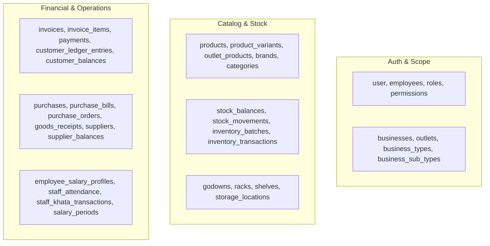

# ERP REST API Endpoint & Network Call Inventory
**Project**: Shree Balaji Enterprises Billing ERP (`NubiBillingSoftware`)  
**Audit Mode**: `AUDIT_FIRST_THEN_SAFE_REFACTOR`  
**Execution Timestamp**: October 23, 2026  
**Auditor**: Antigravity Senior Mobile Architect & API Migration Specialist  
**Status**: COMPLETE (100% Network Calls Inventoried)

---

## 1. Executive Summary

This inventory catalogs every remote backend HTTP call, endpoint URL, method, query pattern, caller location, and data entity in the application.

- **Total Direct HTTP Client Files**: 2 (`lib/core/network/api_client.dart` in production; `test/firestore_sync_rest_test.dart` in tests)
- **Direct HTTP Calls in UI Widgets**: **0**
- **Hardcoded URLs in Feature Code**: **0** (All endpoints resolve via `FirebaseConstants` and `EnvironmentConfig`)
- **Total Canonical Entity Collections Managed**: **73**
- **Current Remote Transport Protocol**: Google Cloud REST v1 APIs (`identitytoolkit`, `securetoken`, `firestore/v1`)

---

## 2. Remote Backend Network Endpoints Inventory

### 2.1 Authentication & Token Endpoints

| Endpoint URL Pattern | HTTP Method | Header Requirements | Payload / Query Params | Calling Class & Location | Business Purpose |
| :--- | :---: | :--- | :--- | :--- | :--- |
| `https://identitytoolkit.googleapis.com/v1/accounts:signInWithPassword?key={API_KEY}` | `POST` | `Content-Type: application/json` | `{"email": "...", "password": "...", "returnSecureToken": true}` | `FirebaseAuthRestService.signIn` [`firebase_auth_rest_service.dart#L20`](file:///d:/Programe/FlutterProject/Project_22.10.26/NubiBillingSoftware/lib/data/services/firebase_auth_rest_service.dart#L20) | User sign-in with email & password; returns JWT ID token & refresh token |
| `https://identitytoolkit.googleapis.com/v1/accounts:signUp?key={API_KEY}` | `POST` | `Content-Type: application/json` | `{"email": "...", "password": "...", "returnSecureToken": true}` | `FirebaseAuthRestService.createEmailPasswordAccount` [`firebase_auth_rest_service.dart#L43`](file:///d:/Programe/FlutterProject/Project_22.10.26/NubiBillingSoftware/lib/data/services/firebase_auth_rest_service.dart#L43) | User registration / provisioning |
| `https://securetoken.googleapis.com/v1/token?key={API_KEY}` | `POST` | `Content-Type: application/x-www-form-urlencoded` | `grant_type=refresh_token&refresh_token={TOKEN}` | `FirebaseAuthRestService.refresh` [`firebase_auth_rest_service.dart#L67`](file:///d:/Programe/FlutterProject/Project_22.10.26/NubiBillingSoftware/lib/data/services/firebase_auth_rest_service.dart#L67) | Token refresh when JWT expires (1-hour lifespan) |

---

### 2.2 Firestore REST v1 Data & Transaction Endpoints

Base URL: `https://firestore.googleapis.com/v1/projects/{PROJECT_ID}/databases/(default)/documents`

| Endpoint URL Pattern | HTTP Method | Header Requirements | Payload / Query Params | Calling Class & Location | Business Purpose |
| :--- | :---: | :--- | :--- | :--- | :--- |
| `GET /documents/app_config/global` | `GET` | `Authorization: Bearer {TOKEN}` (optional) | None | `FirestoreRestService.checkServerAvailability` [`firestore_rest_service.dart#L27`](file:///d:/Programe/FlutterProject/Project_22.10.26/NubiBillingSoftware/lib/data/services/firestore_rest_service.dart#L27) | Ping server reachability check before executing online-only operations |
| `GET /documents/{collection}/{id}` | `GET` | `Authorization: Bearer {TOKEN}` | None | `FirestoreRestService.getDocument` [`firestore_rest_service.dart#L55`](file:///d:/Programe/FlutterProject/Project_22.10.26/NubiBillingSoftware/lib/data/services/firestore_rest_service.dart#L55) | Direct single document fetch by ID |
| `POST /documents/{collection}?documentId={id}` | `POST` | `Authorization: Bearer {TOKEN}`, `Content-Type: application/json` | `{"fields": { ... }}` (typed values) | `FirestoreRestService.createDocument` [`firestore_rest_service.dart#L393`](file:///d:/Programe/FlutterProject/Project_22.10.26/NubiBillingSoftware/lib/data/services/firestore_rest_service.dart#L393) | Single document creation |
| `PATCH /documents/{collection}/{id}?updateMask.fieldPaths={field}` | `PATCH` | `Authorization: Bearer {TOKEN}`, `Content-Type: application/json` | `{"fields": { ... }}` | `FirestoreRestService.updateDocument` [`firestore_rest_service.dart#L420`](file:///d:/Programe/FlutterProject/Project_22.10.26/NubiBillingSoftware/lib/data/services/firestore_rest_service.dart#L420) | Partial document field update |
| `DELETE /documents/{collection}/{id}` | `DELETE` | `Authorization: Bearer {TOKEN}` | None | `FirestoreRestService.deleteDocument` [`firestore_rest_service.dart#L559`](file:///d:/Programe/FlutterProject/Project_22.10.26/NubiBillingSoftware/lib/data/services/firestore_rest_service.dart#L559) | Single document deletion |
| `POST /documents:runQuery` | `POST` | `Authorization: Bearer {TOKEN}`, `Content-Type: application/json` | `{"structuredQuery": {"from": [...], "where": {...}, "orderBy": [...], "limit": N}}` | `FirestoreRestService.queryDocuments` [`firestore_rest_service.dart#L85, L126`](file:///d:/Programe/FlutterProject/Project_22.10.26/NubiBillingSoftware/lib/data/services/firestore_rest_service.dart#L85) | Filtered document queries (single equality or composite AND filters) |
| `POST /documents:runQuery` (Bounded Sync Page) | `POST` | `Authorization: Bearer {TOKEN}`, `Content-Type: application/json` | `{"structuredQuery": {...}, "readTime": "..."}` | `FirestoreRestService.readSyncPage` [`firestore_rest_service.dart#L196`](file:///d:/Programe/FlutterProject/Project_22.10.26/NubiBillingSoftware/lib/data/services/firestore_rest_service.dart#L196) | Cursor-based synchronization pagination with snapshot isolation |
| `POST /documents:runAggregationQuery` | `POST` | `Authorization: Bearer {TOKEN}`, `Content-Type: application/json` | `{"structuredAggregationQuery": {"structuredQuery": {...}, "aggregations": [{"count": {}}, {"sum": {...}}]}}` | `FirestoreRestService.aggregateDocuments` [`firestore_rest_service.dart#L281`](file:///d:/Programe/FlutterProject/Project_22.10.26/NubiBillingSoftware/lib/data/services/firestore_rest_service.dart#L281) | Server-side count and sum aggregations for financial reports |
| `POST /documents:commit` | `POST` | `Authorization: Bearer {TOKEN}`, `Content-Type: application/json` | `{"writes": [{"update": {...}, "currentDocument": {"updateTime": "..."}, "updateTransforms": [...]}]}` | `FirestoreRestService.commitWrites` [`firestore_rest_service.dart#L491`](file:///d:/Programe/FlutterProject/Project_22.10.26/NubiBillingSoftware/lib/data/services/firestore_rest_service.dart#L491) | Multi-document atomic commit (max 500 writes), precondition locking & server timestamp transforms |

---

## 3. URL Reference Audit Across Codebase

Every string matching a URL schema across `lib/` was analyzed:

| File Location | Line | String Literal Found | Purpose & Context | Migration Recommendation |
| :--- | :---: | :--- | :--- | :--- |
| `lib/core/constants/firebase_constants.dart` | 3 | `https://identitytoolkit.googleapis.com/v1` | Identity Toolkit base URL | Move to `ApiConfig.authBaseUrl` |
| `lib/core/constants/firebase_constants.dart` | 4 | `https://securetoken.googleapis.com/v1/token` | Token refresh URL | Move to `ApiConfig.tokenRefreshUrl` |
| `lib/core/constants/firebase_constants.dart` | 5 | `https://firestore.googleapis.com/v1/projects` | Firestore REST documents base URL | Move to `ApiConfig.firestoreBaseUrl` |
| `lib/data/repositories/auth_repository.dart` | 157 | `https://securetoken.google.com/$projectId` | JWT `iss` (issuer) claim validation | Abstract into backend-specific token validator |
| `lib/presentation/about/about_page.dart` | 433-518 | `https://nubibill.com`, `/docs`, `/privacy`, `/terms` | External informational website links (opened via `url_launcher`) | Keep as-is (non-API informational links) |
| `lib/presentation/products/product_pages.dart` | 4089 | `https://example.com/product.jpg` | Placeholder text in UI input field | Keep as-is (UI placeholder) |

**Conclusion**: Zero secret URLs, zero credentials, and zero rogue API endpoints exist in the application code.

---

## 4. Entity Collections & Repositories Inventory

The following 73 collections represent the application's domain schema across local SQLite and remote REST:

### Full Repository Mapping:

| Repository Name | File Path | Operations Used | Collections Accessed |
| :--- | :--- | :--- | :--- |
| `AuthRepository` | `lib/data/repositories/auth_repository.dart` | Sign-in, sign-up, refresh, session cache | Internal auth session / tokens |
| `BillingRepository` | `lib/data/repositories/billing_repository.dart` | Atomic Transactions | `invoices`, `invoice_items`, `payments`, `customerBalances`, `customerLedgerEntries`, `stockBalances`, `stockMovements`, `documentSequences` |
| `BusinessRepository` | `lib/data/repositories/business_repository.dart` | Query, get, atomic create | `businesses`, `businessTypes`, `businessNameReservations` |
| `CustomerRepository` | `lib/data/repositories/customer_repository.dart` | Atomic Transactions, query, CRUD | `customers`, `customerLedgerEntries`, `financialTransactions`, `invoices`, `payments`, `paymentAllocations` |
| `DashboardRepository` | `lib/data/repositories/dashboard_repository.dart` | Read queries, aggregations | `invoices`, `invoiceItems`, `purchaseBills`, `stockBalances`, `products`, `productVariants`, `outletProducts`, `customers` |
| `EmployeeRepository` | `lib/data/repositories/employee_repository.dart` | Atomic Transactions, CRUD | `employees`, `user` |
| `ExpenseRepository` | `lib/data/repositories/expense_repository.dart` | Query, CRUD | `expenses` |
| `InventoryRepository` | `lib/data/repositories/inventory_repository.dart` | Atomic Transactions, query, CRUD | `stockBalances`, `stockMovements`, `inventoryBatches`, `inventoryBatchMovements`, `inventoryTransactions` |
| `OutletRepository` | `lib/data/repositories/outlet_repository.dart` | Atomic Transactions, query, get | `outlets`, `businesses`, `businessSubTypes`, `documentSequences` |
| `ProductRepository` | `lib/data/repositories/product_repository.dart` | Atomic Transactions, query, patch | `products`, `productVariants`, `outletProducts`, `brands`, `productCategories`, `productSubcategories`, `packSizes`, `units`, `hsnCodes`, `stockBalances`, `documentSequences` |
| `PurchaseRepository` | `lib/data/repositories/purchase_repository.dart` | Atomic Transactions, query, CRUD | `purchases`, `purchaseBills`, `purchaseBillItems`, `purchaseOrders`, `goodsReceipts`, `suppliers`, `supplierBalances`, `supplierLedgerEntries`, `supplierPayments`, `stockBalances` |
| `ReportsRepository` | `lib/data/repositories/reports_repository.dart` | Snapshot queries, aggregations | `invoices`, `invoiceItems`, `purchaseBills`, `stockBalances`, `stockMovements`, `expenses`, `financialTransactions`, `customers` |
| `SalesRepository` | `lib/data/repositories/sales_repository.dart` | Atomic Transactions, query | `invoices`, `customers`, `customerLedgerEntries`, `stockBalances`, `inventoryBatches`, `inventoryBatchMovements`, `staffKhataTransactions`, `documentSequences` |
| `StaffAttendanceRepository` | `lib/data/repositories/staff_attendance_repository.dart` | Atomic Transactions, query | `staffAttendance`, `staffAttendanceEvents`, `employees`, `outlets` |
| `StaffSalaryRepository` | `lib/data/repositories/staff_salary_repository.dart` | Atomic Transactions, query | `employeeSalaryProfiles`, `employeeOutletAllocations`, `staffKhataTransactions`, `salaryPeriods`, `staffAttendance`, `financialTransactions`, `invoices`, `payments` |
| `StorageRepository` | `lib/data/repositories/storage_repository.dart` | Atomic Transactions, query | `godowns`, `godownCodeReservations`, `racks`, `shelves`, `stockBalances`, `documentSequences` |
| `SupplierRepository` | `lib/data/repositories/supplier_repository.dart` | Atomic Transactions, query, CRUD | `suppliers`, `supplierBusinesses`, `supplierBalances`, `supplierLedgerEntries`, `supplierPayments`, `supplierRefunds`, `financialTransactions` |
| `UserRepository` | `lib/data/repositories/user_repository.dart` | Get, update, CRUD | `user` |
