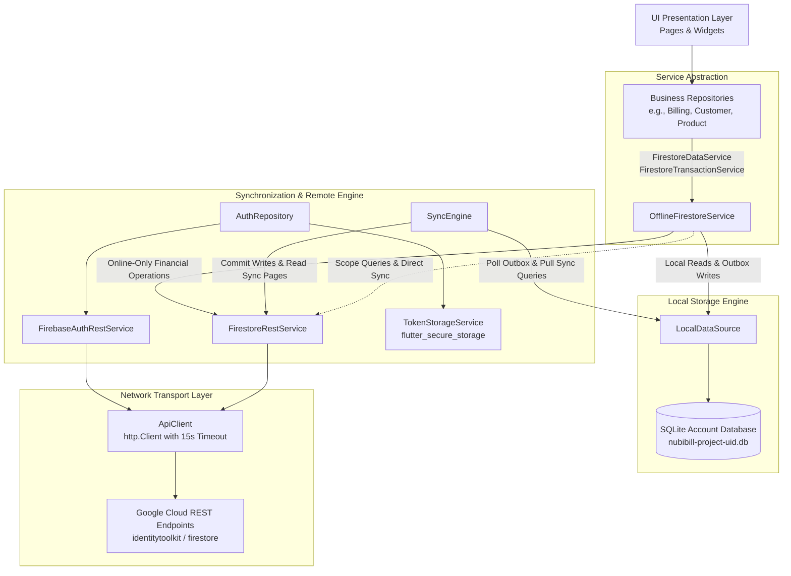

# Current API & Data Architecture Analysis
**Project**: Shree Balaji Enterprises Billing ERP (`NubiBillingSoftware`)  
**Audit Mode**: `AUDIT_FIRST_THEN_SAFE_REFACTOR`  
**Execution Timestamp**: October 23, 2026  
**Auditor**: Antigravity Senior Mobile Architect & API Migration Specialist  
**Status**: COMPLETE

---

## 1. Architectural Overview

The application features an offline-first architecture with a dual data path:
1. **Local Path (Offline-First)**: UI and Business Repositories primarily communicate with `OfflineFirestoreService`, which reads and writes to local SQLite database files via `LocalDataSource`. Mutations are queued in `sync_outbox`.
2. **Remote Path (Online Sync & Server-Confirmed Transactions)**: 
   - Non-financial mutations are uploaded in the background by `SyncEngine` using `FirestoreRestService`.
   - Critical financial operations (invoice payment, due collection, advance payments, ledger postings) strictly bypass offline queuing and execute directly against the remote REST server via `FirestoreRestService.runAtomicOperation`.



---

## 2. Authentication & Session Architecture

### 2.1 Services & Components
- **`FirebaseAuthRestService`** ([`firebase_auth_rest_service.dart`](file:///d:/Programe/FlutterProject/Project_22.10.26/NubiBillingSoftware/lib/data/services/firebase_auth_rest_service.dart)):
  - Calls Google Identity Toolkit REST API (`accounts:signInWithPassword`, `accounts:signUp`, and Secure Token `token` refresh).
  - Handles error mapping from Firebase REST error codes (`INVALID_LOGIN_CREDENTIALS`, `TOO_MANY_ATTEMPTS_TRY_LATER`, etc.) to domain `AppException`.
- **`TokenStorageService`** ([`token_storage.dart`](file:///d:/Programe/FlutterProject/Project_22.10.26/NubiBillingSoftware/lib/core/storage/token_storage.dart)):
  - Persists session credentials (`idToken`, `refreshToken`, `uid`, `email`, `expiresAt`) using `flutter_secure_storage`.
  - Employs fallback strategies across desktop and mobile platforms.
- **`AuthSession`** ([`auth_session_model.dart`](file:///d:/Programe/FlutterProject/Project_22.10.26/NubiBillingSoftware/lib/data/models/auth_session_model.dart)):
  - Decodes unverified base64 JWT payload claims (`sub`, `aud`, `iss`, `email`, `exp`).
  - Calculates expiration thresholds to proactively trigger token refresh before network calls expire.
- **`AuthRepository`** ([`auth_repository.dart`](file:///d:/Programe/FlutterProject/Project_22.10.26/NubiBillingSoftware/lib/data/repositories/auth_repository.dart)):
  - Manages session lifecycle, silent refresh, offline credentials caching, and token validation against `EnvironmentConfig.projectId`.

---

## 3. Network Transport Layer (`ApiClient`)

[`ApiClient`](file:///d:/Programe/FlutterProject/Project_22.10.26/NubiBillingSoftware/lib/core/network/api_client.dart) provides the foundational HTTP abstraction:
- **Methods**: `get(uri, token)`, `post(uri, body, headers)`, `postList(uri, body, headers)`, `patch(uri, body, token, headers)`, `delete(uri, token)`.
- **Timeouts**: Fixed `Duration(seconds: 15)`.
- **Response Decoding**: Expects JSON body; unwraps status codes $\ge 200 \land < 300$; converts HTTP error responses into `AppException`.
- **Logging & Diagnostics**: 
  - Tracks request latency and response document counts.
  - Automatically redacts sensitive fields (passwords, tokens, API keys, emails) in debug logs.
  - Logs Firestore structured query reads when in debug mode.

---

## 4. Local SQLite Persistence & Data Synchronization

### 4.1 Schema Isolation & Structure
- SQLite databases are created per tenant account: `nubibill-{projectId}-{uid}.db`.
- **Collection Tables** (`LocalDatabaseTables.tables`): 73 canonical tables named `local_<collection>`.
- **Table Structure**:
  ```sql
  CREATE TABLE local_customers (
    remoteId TEXT PRIMARY KEY,
    payloadJson TEXT NOT NULL,
    scopeType TEXT, status TEXT, catalogueId TEXT,
    businessTypeId TEXT, businessSubTypeId TEXT,
    tenantId TEXT, businessId TEXT, outletId TEXT,
    categoryId TEXT, subcategoryId TEXT, attributeId TEXT,
    syncStatus TEXT NOT NULL DEFAULT 'SYNCED',
    localUpdatedAt TEXT NOT NULL, remoteUpdatedAt TEXT,
    remoteUpdateTime TEXT, lastSyncedAt TEXT,
    isDeleted INTEGER NOT NULL DEFAULT 0, syncError TEXT,
    localRevision INTEGER NOT NULL DEFAULT 0,
    acknowledgedRevision INTEGER NOT NULL DEFAULT 0
  );
  ```
- **Sync Tables**:
  - `sync_outbox`: Queues local mutations (`CREATE`, `UPDATE`, `DELETE`) with `readSetJson` for conflict detection.
  - `sync_queries`: Tracks registered query scopes and synchronization cursors.
  - `sync_conflicts`: Records server-rejected or mismatched mutations.
  - `sync_lease`: Prevents concurrent sync engines from operating simultaneously on the same local database.

### 4.2 Financial Boundary Enforcement
As defined in `SyncOutboxRepository`:
```dart
static const financialCollections = {
  'payments', 'payment_allocations', 'customer_ledger_entries',
  'financial_transactions', 'supplier_payments', 'supplier_credits',
  'supplier_ledger_entries', 'supplier_refunds',
};
```
If an offline mutation attempts to write to any of these collections, `SyncOutboxRepository` and `OfflineFirestoreService` reject it with `offline-financial-prohibited`. Financial mutations **must** run online via `FirestoreRestService.runAtomicOperation`.

---

## 5. Model Serialization & Wire Format (`FirestoreValueCodec`)

Currently, domain models like `CustomerModel`, `ProductModel`, `InvoiceModel` interact with `Map<String, dynamic>`. However:
1. When communicating with Firestore REST, fields must be wrapped in Firestore type descriptors:
   - Strings: `{"stringValue": "value"}`
   - Integers: `{"integerValue": "100"}`
   - Booleans: `{"booleanValue": true}`
   - Maps: `{"mapValue": {"fields": {...}}}`
   - Arrays: `{"arrayValue": {"values": [...]}}`
2. `FirestoreValueCodec` ([`firestore_value_codec.dart`](file:///d:/Programe/FlutterProject/Project_22.10.26/NubiBillingSoftware/lib/data/services/firestore_value_codec.dart)) handles this bi-directional conversion.
3. In local SQLite, `payloadJson` stores the JSON string of encoded fields.

---

## 6. Architectural Strengths & Current Limitations

### Strengths:
1. **Zero Flutter Firebase SDKs**: Pure Dart implementation; runs reliably on Android, Windows, macOS, iOS, Linux, and Web without binary plugin conflicts.
2. **Robust Offline SQLite Cache**: Transparent offline reading and querying with indexing across multi-tenant scopes (`tenantId`, `businessId`, `outletId`).
3. **Strict Financial Safety**: Financial integrity rules prevent dirty offline financial posting and prevent double-settlement via atomic server preconditions.
4. **Clean UI Decoupling**: Zero HTTP calls in UI widgets; all UI interactions use controllers/repositories.

### Limitations & Coupling to be Refactored:
1. **Firestore Protocol Coupling**: Repositories and `OfflineFirestoreService` are named after and coupled to Firestore concepts (`FirestoreDataService`, `FirestoreFilter`, `FirestoreWrite`, `updateTime` preconditions, `FirestoreValueCodec`).
2. **Direct Firestore Query Syntax**: Filtering relies on Firestore REST operators (`EQUAL`, `GREATER_THAN_OR_EQUAL`, `compositeFilter`).
3. **Hardcoded Base Constants**: URLs and collections are grouped in `FirebaseConstants`.
4. **Lack of Backend Polymorphism**: The system cannot swap the remote adapter to a PHP/PostgreSQL backend without touching `OfflineFirestoreService` and `SyncEngine`.
