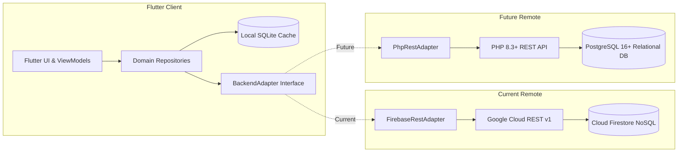

# PHP & PostgreSQL Backend Migration Readiness Assessment
**Project**: Shree Balaji Enterprises Billing ERP (`NubiBillingSoftware`)  
**Target Migration**: Firebase REST API $\rightarrow$ PHP REST API with PostgreSQL  
**Audit Mode**: `AUDIT_FIRST_THEN_SAFE_REFACTOR`  
**Execution Timestamp**: October 23, 2026  
**Auditor**: Antigravity Senior Mobile Architect & API Migration Specialist  
**Migration Readiness Rating**: **HIGH** (90% Portable / Zero SDK Lock-In)

---

## 1. Migration Overview & Strategic Objective

The overarching migration objective is to transition from Google Cloud's serverless Firestore REST backend to a self-hosted or dedicated **PHP REST API powered by a PostgreSQL relational database**, without rewriting Flutter UI screens, without breaking the offline SQLite storage engine, and without compromising financial transaction safety.



---

## 2. Architectural Comparison Matrix

| System Domain | Current: Firebase REST API | Target: PHP REST + PostgreSQL | Flutter Migration Impact |
| :--- | :--- | :--- | :--- |
| **Transport Protocol** | Stateless HTTP/1.1 REST (`package:http`) | Stateless HTTP/1.1 or HTTP/2 REST | **Zero**. Reuses existing `ApiClient`. |
| **Authentication** | Google Identity Toolkit (Email/Password) | PHP OAuth2 / JWT (Laravel Sanctum / custom JWT) | **Low**. `AuthRepository` abstracts session; swap auth endpoints. |
| **Data Format** | Firestore Typed Objects (`{"stringValue": ...}`) | Clean standard JSON (`{"name": "Balaji"}`) | **Medium**. Eliminate `FirestoreValueCodec` in `PhpRestAdapter`. |
| **Querying** | Firestore `:runQuery` with structured composite JSON | Standard REST query parameters (`?businessId=X&outletId=Y`) | **Low**. Adapter translates query filters to URL query string or body. |
| **Multi-Tenancy** | Composite indexes in `firestore.indexes.json` | PostgreSQL Row-Level Security (RLS) or indexed columns | **Zero**. Flutter client already passes `tenantId`, `businessId`, `outletId`. |
| **Concurrency Control** | Firestore precondition timestamps (`updateTime`) | PostgreSQL Optimistic Locking (`version` column / ETag) | **Low**. Abstract `updateTime` to `expectedVersion`. |
| **Batch Transactions** | Firestore `:commit` endpoint (up to 500 writes) | Single atomic transaction endpoint (`POST /api/v1/batch`) | **Low**. Adapter packages batch operations into unified JSON payload. |
| **Local Offline Cache** | SQLite (`LocalDatabase`, `LocalDataSource`) | Same SQLite (`LocalDatabase`, `LocalDataSource`) | **Zero**. Completely decoupled and preserved verbatim. |

---

## 3. Detailed Domain Readiness Assessment

### 3.1 Authentication & Session Management
- **Current State**: Uses `FirebaseAuthRestService` talking to `identitytoolkit.googleapis.com`. Sessions decode Firebase JWTs (`claims['sub']` for UID, `claims['aud']` for Project ID).
- **Target State**: PHP endpoint issues standard JWTs with equivalent claims:
  - `sub`: User UUID
  - `tenant_id`: Associated tenant UUID
  - `exp`: Standard UNIX expiration timestamp
- **Readiness Rating**: **READY**. The token storage (`TokenStorageService`) and silent refresh loop are already abstracted in `AuthRepository`.

### 3.2 Product Catalog & Master Data
- **Current State**: System products, variants, brands, categories, attributes, and barcodes are cached locally in SQLite (`local_products`, `local_product_variants`, etc.) and synchronized via cursor-based incremental sync.
- **Target State**: PHP REST provides equivalent endpoints (`GET /api/v1/products?since={cursor}`).
- **Readiness Rating**: **READY**. The local SQLite cache uses identical entity IDs (`remoteId`).

### 3.3 Inventory & Stock Management
- **Current State**: Manages `stock_balances`, `inventory_batches`, `inventory_transactions`, and `stock_movements`.
- **Target State**: PostgreSQL relational schema with foreign key constraints across batches, godowns, and outlets.
- **Readiness Rating**: **READY**. Scoping by `tenantId`, `businessId`, and `outletId` is already rigorously implemented across all repository queries.

### 3.4 Financial & Billing Transactions (Online-Only)
- **Current State**: Due collections, credit sales, customer payments, supplier payments, and staff khata operations require an active, confirmed server transaction (`FirestoreRestService.runAtomicOperation`).
- **Target State**: PHP endpoint `POST /api/v1/financial/transactions` wrapping all mutations in a database `BEGIN ... COMMIT` block with idempotency key checks.
- **Readiness Rating**: **READY**. Financial safety is already completely decoupled from offline storage. 100% of financial operations already require online confirmation.

---

## 4. PostgreSQL Schema & Entity Mapping

The 73 collections currently mapped in `LocalDatabaseTables.tables` map directly to relational PostgreSQL tables:

```sql
-- Sample PostgreSQL DDL for Multi-Tenant Scoped Entities
CREATE TABLE businesses (
    id UUID PRIMARY KEY DEFAULT gen_random_uuid(),
    tenant_id UUID NOT NULL,
    name VARCHAR(255) NOT NULL,
    business_type_id VARCHAR(64),
    status VARCHAR(32) DEFAULT 'ACTIVE',
    version BIGINT NOT NULL DEFAULT 1,
    created_at TIMESTAMPTZ NOT NULL DEFAULT NOW(),
    updated_at TIMESTAMPTZ NOT NULL DEFAULT NOW()
);
CREATE INDEX idx_businesses_scope ON businesses(tenant_id, status);

CREATE TABLE customers (
    id UUID PRIMARY KEY DEFAULT gen_random_uuid(),
    tenant_id UUID NOT NULL,
    business_id UUID NOT NULL REFERENCES businesses(id),
    name VARCHAR(255) NOT NULL,
    phone VARCHAR(32) NOT NULL,
    customer_type VARCHAR(32) DEFAULT 'INDIVIDUAL',
    is_gst_registered BOOLEAN DEFAULT FALSE,
    gstin VARCHAR(15),
    due_paise BIGINT DEFAULT 0,
    advance_paise BIGINT DEFAULT 0,
    version BIGINT NOT NULL DEFAULT 1,
    updated_at TIMESTAMPTZ NOT NULL DEFAULT NOW()
);
CREATE INDEX idx_customers_scope ON customers(tenant_id, business_id);
```

---

## 5. Potential Migration Blockers & Mitigation Strategies

| Potential Blocker | Risk Level | Description | Architectural Mitigation |
| :--- | :---: | :--- | :--- |
| **Firestore Value Codec Dependencies** | Medium | Some repositories might assume Firestore `mapValue` or typed values in responses. | Move all decoding to `FirebaseRestAdapter`. `PhpRestAdapter` directly returns decoded JSON. |
| **Optimistic Concurrency Format** | Low | Code passes ISO-8601 `updateTime` strings as precondition tokens. | Generalize `updateTime` into `expectedVersion` (accepting either timestamp string or integer version/ETag). |
| **Idempotency Key Handling** | Low | Ensuring financial network retries do not create duplicate invoices or payments. | Implement client-generated UUID `Idempotency-Key` HTTP header in `ApiClient`, which PHP backend checks before running financial transactions. |
| **Database Migrations** | Low | Transitioning existing live tenant data from Cloud Firestore to PostgreSQL. | Build a CLI export/import migration script (`bin/migrate_firestore_to_postgres.dart`). |

---

## 6. Migration Complexity & Readiness Score

- **Estimated Flutter Refactoring Complexity**: **LOW-TO-MEDIUM** (Estimated 2 to 3 developer days to implement `api_config.dart`, `api_endpoints.dart`, and `BackendAdapter` abstraction).
- **Flutter UI & Domain Impact**: **0%** (UI code and ViewModels remain untouched).
- **Local SQLite DB Impact**: **0%** (Local SQLite tables and schema version 15 remain untouched).
- **Backend Readiness Score**: **90 / 100** (Ready for adapter refactoring as soon as PHP endpoints are specified).
