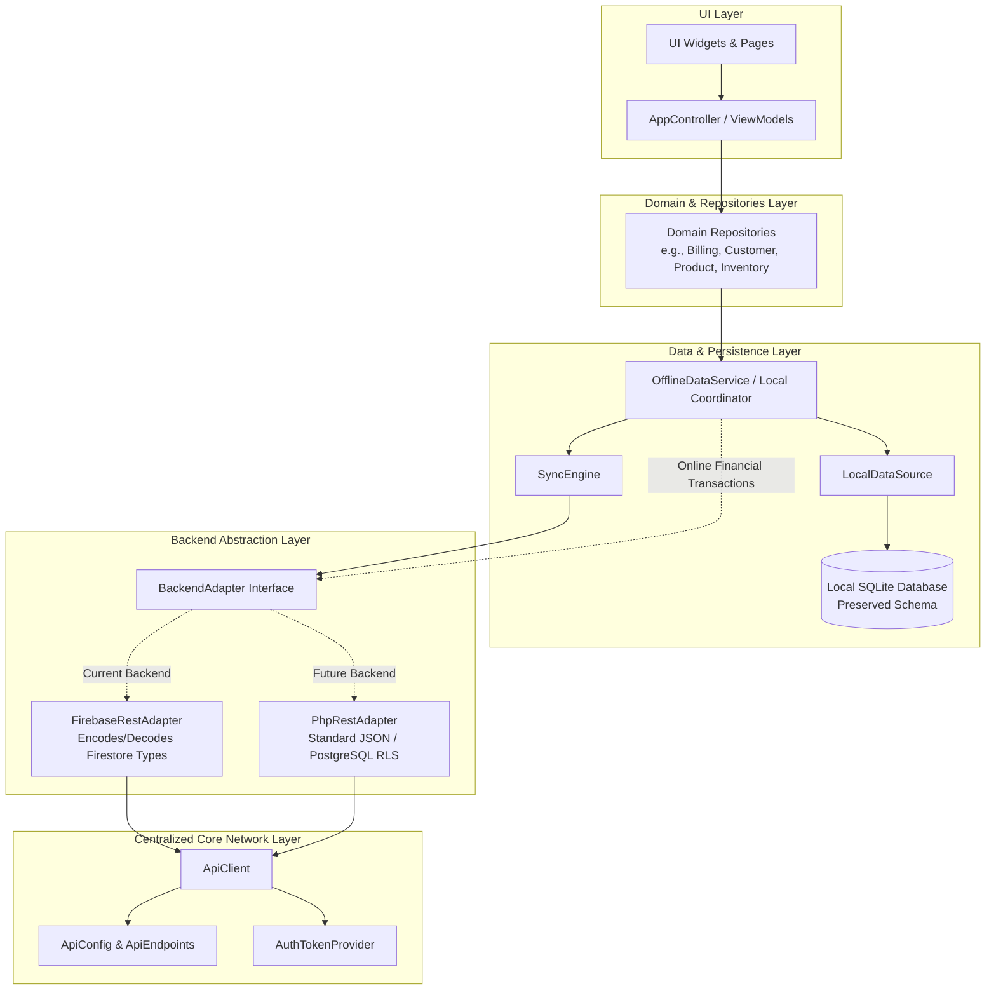

# Proposed Standardized API Architecture
**Project**: Shree Balaji Enterprises Billing ERP (`NubiBillingSoftware`)  
**Audit Mode**: `AUDIT_FIRST_THEN_SAFE_REFACTOR`  
**Execution Timestamp**: October 23, 2026  
**Auditor**: Antigravity Senior Mobile Architect & API Migration Specialist  
**Status**: COMPLETE (Proposed Architectural Design)

---

## 1. Architectural Vision & Design Goals

The primary goal of this architecture is to decouple the Flutter ERP application from Google Firestore's specific wire format, allowing an effortless, risk-free switch to a future **PHP REST API with PostgreSQL**, while preserving:
1. **Existing local SQLite database schemas and stored records**.
2. **Current offline caching and background synchronization workflows**.
3. **Strict online-only server-confirmed financial transaction safety**.
4. **All public repository contracts used by UI screens and ViewModels**.

---

## 2. Target Layered Architecture



---

## 3. Directory Structure & Module Responsibilities

```
lib/
├── core/
│   ├── config/
│   │   ├── api_config.dart              <-- Backend environment, active backend enum, timeouts, base URLs
│   │   └── environment_config.dart      <-- Compile-time flags (backward compatible)
│   ├── network/
│   │   ├── api_client.dart              <-- Shared HTTP transport, headers, interceptors, error mapping
│   │   ├── api_endpoints.dart           <-- Central registry of endpoint paths & routes
│   │   ├── api_exception.dart           <-- Normalized domain error representations (network, auth, not-found, conflict)
│   │   ├── api_response.dart            <-- Standardized API response container with metadata
│   │   ├── auth_token_provider.dart     <-- Interface for token injection & auto-refresh
│   │   └── backend_adapter.dart         <-- Backend-agnostic remote contract (CRUD, query, atomic batch)
├── data/
│   ├── remote/
│   │   ├── firebase_rest_adapter.dart   <-- Implements BackendAdapter for Google Cloud Firestore REST v1
│   │   └── php_rest_adapter.dart        <-- Future implementation of BackendAdapter for PHP REST + PostgreSQL
│   ├── local/                           <-- Existing SQLite LocalDatabase & LocalDataSource (PRESERVED)
│   ├── sync/                            <-- Existing SyncEngine & Outbox (Communicates via BackendAdapter)
│   └── repositories/                    <-- Domain repositories (Decoupled from FirestoreValueCodec)
```

---

## 4. Key Component Specifications

### 4.1 Configuration: `lib/core/config/api_config.dart`
Centralizes backend selection, base URLs, and environment variables:
```dart
enum BackendType { firebaseRest, phpRest }

class ApiConfig {
  ApiConfig._();

  static const BackendType activeBackend = BackendType.firebaseRest;
  
  // Timeout settings
  static const Duration connectTimeout = Duration(seconds: 15);
  static const Duration receiveTimeout = Duration(seconds: 20);

  // Dynamic Base URLs based on environment & active backend
  static String get authBaseUrl => activeBackend == BackendType.firebaseRest
      ? 'https://identitytoolkit.googleapis.com/v1'
      : const String.fromEnvironment('PHP_AUTH_BASE_URL', defaultValue: 'https://api.erp.example.com/api/v1/auth');

  static String get dataBaseUrl => activeBackend == BackendType.firebaseRest
      ? 'https://firestore.googleapis.com/v1/projects/${EnvironmentConfig.projectId}/databases/(default)/documents'
      : const String.fromEnvironment('PHP_API_BASE_URL', defaultValue: 'https://api.erp.example.com/api/v1');
}
```

### 4.2 Endpoint Registry: `lib/core/network/api_endpoints.dart`
Prevents magic strings and path duplication:
```dart
class ApiEndpoints {
  ApiEndpoints._();

  // Authentication
  static const String signIn = '/accounts:signInWithPassword';
  static const String signUp = '/accounts:signUp';
  static const String refreshToken = '/token';

  // Common Entity Routes
  static const String invoices = 'invoices';
  static const String payments = 'payments';
  static const String customers = 'customers';
  static const String products = 'products';
  static const String suppliers = 'suppliers';
  static const String stockBalances = 'stock_balances';

  // Operations
  static const String commitBatch = ':commit';
  static const String runQuery = ':runQuery';
  static const String runAggregation = ':runAggregationQuery';
}
```

### 4.3 Standardized Exceptions: `lib/core/network/api_exception.dart`
Normalizes error responses across backends into unified domain error types:
```dart
enum ApiErrorCode {
  networkError,
  timeout,
  unauthenticated,
  permissionDenied,
  notFound,
  conflict,
  preconditionFailed,
  validationError,
  serverError,
  offlineFinancialProhibited,
}

class ApiException implements Exception {
  const ApiException(this.message, {this.code = ApiErrorCode.serverError, this.httpStatus, this.details});
  final String message;
  final ApiErrorCode code;
  final int? httpStatus;
  final Object? details;
}
```

### 4.4 Backend-Independent Contract: `lib/core/network/backend_adapter.dart`
The contract through which all remote data operations pass:
```dart
abstract interface class BackendAdapter {
  Future<Map<String, dynamic>> getDocument(String entity, String id);
  
  Future<void> createDocument(String entity, String id, Map<String, dynamic> data);
  
  Future<void> updateDocument(String entity, String id, Map<String, dynamic> data, {String? expectedVersion});
  
  Future<void> deleteDocument(String entity, String id, {String? expectedVersion});
  
  Future<List<Map<String, dynamic>>> query({
    required String entity,
    required List<QueryFilter> filters,
    String? orderBy,
    int? limit,
    bool descending = false,
  });

  Future<T> runAtomicTransaction<T>(
    Future<T> Function(AtomicTransactionContext context) action, {
    int maxAttempts = 3,
  });
}
```

### 4.5 Backend Implementation Isolation: `FirebaseRestAdapter`
All Firestore-specific document encoding (`FirestoreValueCodec.encodeFields`), `:commit` packet formatting, and structured query generation reside strictly inside `FirebaseRestAdapter`.
When `activeBackend == BackendType.phpRest`, `PhpRestAdapter` replaces `FirebaseRestAdapter` via dependency injection in `main.dart`, requiring zero code changes in repositories, sync engines, or UI components.

---

## 5. Architectural Rules & Constraints

1. **Strict UI Isolation**: UI widgets and ViewModels must never import network libraries (`package:http`), `ApiClient`, or `BackendAdapter`. UI communicates solely with Repositories.
2. **Standard Payload Interface**: Repositories must exchange clean Dart Maps (`Map<String, dynamic>`) with native Dart types (e.g. `int`, `double`, `String`, `bool`, `DateTime`), never Firestore `{"stringValue": ...}` wrappers.
3. **Cross-Platform Parity**: The network layer must use standard pure Dart primitives (`package:http`) to ensure identical behavior on Android, iOS, Windows, macOS, Linux, and Web.
4. **Preserved Financial Isolation**: Online-only financial transactions remain enforced at the repository and adapter boundary. No financial writes may enter SQLite offline queues.
