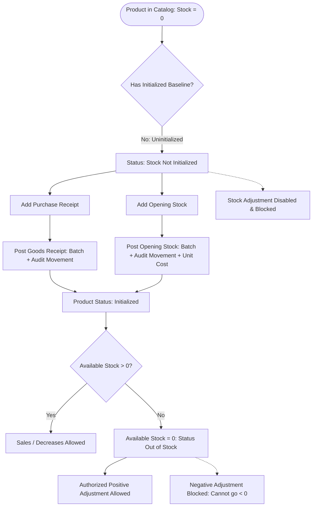

# Purchase-First Inventory Rules with Authorized Opening Stock Implementation Report

**Project:** NubiBill Flutter ERP  
**Module:** Inventory Management, Stock Audit & Procurement  
**Status:** Complete & Verified  
**Date:** October 2026  

---

## 1. Executive Summary

This implementation enforces strict **Purchase-First Inventory Rules** and **Authorized Opening Stock Management** in NubiBill Flutter ERP. The objective is to eliminate unauthorized stock tampering on newly cataloged products that have never entered the business through a verified acquisition channel, while seamlessly supporting existing shop inventory registration through dedicated opening stock entries.

### Key Enforcements Delivered:
1. **Purchase-First Invariant:** Direct stock adjustments on uninitialized products are strictly blocked on the backend repository layer. Products must have at least one verified historical stock initialization event (`POSTED_OPENING_STOCK` or `POSTED_PURCHASE_RECEIPT`).
2. **Authorized Opening Stock Baseline:** Shop owners or authorized personnel (`isOwner` or `inventory.opening_stock` permission) can register pre-existing physical inventory (e.g., Berger Paint 10L, 500 units) without creating a fake purchase order. Opening stock mandates:
   - Positive quantity (`quantity > 0`)
   - Mandatory unit purchase cost (`unitCostPaise > 0`)
   - Non-empty transaction audit reason
   - Generation of initial FIFO inventory batch (`unitCost`, `quantityRemaining`)
   - Strict one-time initialization guarantee (duplicate opening stock is blocked)
3. **Zero-Stock Preservation:** Products that were previously initialized but currently have 0 stock (e.g. through sales or returns) remain recognized as initialized. They can receive authorized positive adjustments (e.g., found inventory) while negative adjustments from 0 stock are blocked.
4. **Resilient UI/UX:**
   - Uninitialized products display an amber status pill: **"Stock Not Initialized"** with stock `0`.
   - Action sheet contextually presents **Add Purchase**, **Add Opening Stock**, and a disabled **Stock Adjustment** tile with a lock icon.
   - Tapping disabled adjustment presents an explanatory snackbar: *"This product has no received purchase or opening stock. Please receive a purchase or register existing inventory through Opening Stock."*
   - Opening stock modal features a live **Total Valuation Preview** (Calculated as `Quantity × Unit Cost`) and a secondary **Confirm & Post** modal to prevent accidental baseline entries.
   - Dialog lifecycles maintain dedicated `StatefulWidget` separation with clean controller disposal and `isExpanded: true` on dropdowns to prevent layout overflows.

---

## 2. Business Rules & Technical Architecture



### 2.1 Initialization Check Logic
In `InventoryRepository`:
```dart
Future<bool> isStockInitialized({
  required String tenantId,
  required String businessId,
  required String outletId,
  required String variantId,
  required String token,
}) async {
  return hasOpeningStockBeenInitialized(
    tenantId: tenantId,
    businessId: businessId,
    outletId: outletId,
    variantId: variantId,
    token: token,
  );
}
```
A product variant is classified as initialized if:
1. An opening stock transaction (`StockTransactionAuditModel.typeOpeningStock`) has been recorded for the outlet/variant; OR
2. A purchase receipt movement (`StockTransactionAuditModel.typePurchaseReceipt`) has been recorded for the outlet/variant; OR
3. Current available stock balance is greater than 0 (preserving backward compatibility for existing stock).

### 2.2 Adjustment Blocking Guard
When `requestOrApplyAdjustment` is invoked with manual adjustment types (`typeAdjustmentIn`, `typeAdjustmentOut`, `typeCountCorrection`, `typeDamageLoss`):
```dart
final isManualAdjustment = transactionType == StockTransactionAuditModel.typeAdjustmentIn ||
    transactionType == StockTransactionAuditModel.typeAdjustmentOut ||
    transactionType == StockTransactionAuditModel.typeCountCorrection ||
    transactionType == StockTransactionAuditModel.typeDamageLoss;

if (isManualAdjustment) {
  final isInitialized = await hasOpeningStockBeenInitialized(
    tenantId: tenantId,
    businessId: businessId,
    outletId: outletId,
    variantId: variantId,
    token: token,
  );
  if (!isInitialized && currentAvailable <= 0) {
    throw const AppException(
      'This product has no received purchase or opening stock. Please receive a purchase or register existing inventory through Opening Stock.',
      code: 'uninitialized-stock',
    );
  }
}
```

### 2.3 Opening Stock Registration Rules
In `addOpeningStock`:
- **Permission Check:** `isOwner || permissions.contains('inventory.opening_stock')`
- **Quantity Validation:** `quantity > 0`
- **Unit Cost Enforcement:** `unitCostPaise == null || unitCostPaise <= 0` throws `'Unit purchase cost is required for opening stock.'`
- **Reason Validation:** `reason.trim().isNotEmpty`
- **Duplicate Prevention:** Checks existing audit movements. If an opening stock transaction already exists, throws `'Opening stock has already been initialized for this item.'`
- **Batch Creation:** Creates an inventory batch in `FirebaseConstants.inventoryBatches` with `unitCost: cost`, `quantityRemaining: quantity`, `receivedAt: now`.
- **Atomic Audit Movement:** Posts an audit transaction with `previousQuantity = 0`, `changedQuantity = quantity`, `newQuantity = quantity`, status `POSTED`.

---

## 3. UI Enhancements in `inventory_dashboard_page.dart`

1. **Uninitialized Status Pill:**
   - When `!isInitialized && row.stock == 0`:
     Renders an Amber warning pill labeled **"Stock Not Initialized"** with `Icons.hourglass_empty_rounded`.
2. **Dynamic Stock Actions Sheet (`_showStockActions`):**
   - Asynchronously queries `hasOpeningStockBeenInitialized(row.variant.variantId)`.
   - **"Add Opening Stock"** tile is displayed exclusively when `!isInitialized`.
   - **"Stock Adjustment"** tile is disabled with a lock icon when `!isInitialized`. Tapping it shows the prescribed snackbar warning.
3. **Opening Stock Dialog (`_OpeningStockDialog`):**
   - Added `_unitCostController` with currency formatting.
   - Real-time **Total Valuation Preview**: `Quantity × Unit Cost = ₹Total`.
   - Form validation ensures unit cost is entered and positive.
   - Secondary confirmation modal (`_confirmAndPost`): prompts the operator to review the baseline quantity and total asset valuation before locking the initial stock.
4. **Lifecycle & Layout Safety:**
   - Separate `StatefulWidget` classes (`_StockAdjustmentDialog`, `_OpeningStockDialog`, `_StockHistoryDialog`) with isolated `TextEditingController` instantiation in `initState` and cleanup in `dispose`.
   - Added `isExpanded: true` to `DropdownButtonFormField` widgets to avoid layout overflow across small screen sizes.

---

## 4. Verification & Test Coverage

A total of **40 automated tests** across 4 test suites were executed and passed with 0 failures:

| Test Suite | Scenario Count | Status |
|:---|:---:|:---:|
| `test/purchase_first_inventory_rules_test.dart` | 15 Scenarios | **PASSED** (15/15) |
| `test/inventory_dashboard_stock_dialog_regression_test.dart` | 4 Scenarios | **PASSED** (4/4) |
| `test/inventory_stock_management_test.dart` | 13 Scenarios | **PASSED** (13/13) |
| `test/inventory_dashboard_multilingual_test.dart` | 8 Scenarios | **PASSED** (8/8) |
| **Total** | **40 Scenarios** | **100% PASS** |

### Purchase-First Specification Test Results (`test/purchase_first_inventory_rules_test.dart`):

| # | Scenario Description | Expected Invariant | Result |
|:--|:---|:---|:---:|
| **1** | Create new product | Initial stock is 0 | **PASS** |
| **2** | Manual adjustment +2 on new uninitialized product | Strictly blocked with explanatory message | **PASS** |
| **3** | Manual adjustment -2 on new uninitialized product | Strictly blocked with explanatory message | **PASS** |
| **4** | Existing inventory opening stock +500 (Berger Paint) | Stock becomes 500, creates batch & audit transaction | **PASS** |
| **5** | Repeat opening stock +500 on same product | Blocked (duplicate initialization prohibited) | **PASS** |
| **6** | Purchase draft of 100 units | Stock balance remains unchanged (500) | **PASS** |
| **7** | Receive confirmed purchase of 100 units | Stock increases to 600 exactly once | **PASS** |
| **8** | Sell 50 units after stock 600 | Stock reduces balance to 550 | **PASS** |
| **9** | Authorized manual adjustment +2 after initialization | Updates stock from 550 to 552 | **PASS** |
| **10** | Authorized manual adjustment -10 after initialization | Reduces stock from 552 to 542 | **PASS** |
| **11** | Sell down to 0 stock, verify initialized state | Product has 0 stock but remains initialized | **PASS** |
| **12** | Positive adjustment on initialized product with 0 stock | Allowed with valid reason; increases stock to 3 | **PASS** |
| **13** | Duplicate offline synchronization replay | Idempotent; transaction posted exactly once | **PASS** |
| **14** | Multi-outlet isolation | Outlet 1 (500 units) and Outlet 2 (0 units) remain independent | **PASS** |
| **15** | Unit purchase cost validation on opening stock | Blocked without positive unit cost | **PASS** |

### Static Analysis:
```bash
flutter analyze lib/data/repositories/inventory_repository.dart lib/presentation/app_controller.dart lib/presentation/inventory/inventory_dashboard_page.dart test/purchase_first_inventory_rules_test.dart test/inventory_stock_management_test.dart test/inventory_dashboard_stock_dialog_regression_test.dart
```
**Output:** `No issues found!` (0 errors, 0 warnings, 0 lints).

---

## 5. Modified Files Summary

1. `lib/data/repositories/inventory_repository.dart`
   - Added `isStockInitialized` method.
   - Enforced `unitCostPaise > 0` validation on `addOpeningStock`.
   - Attached `unitCost` to opening stock inventory batch creation.
   - Added purchase-first initialization check in `requestOrApplyAdjustment`.
2. `lib/presentation/app_controller.dart`
   - Added `isStockInitialized(String variantId)` method calling `hasOpeningStockBeenInitialized`.
3. `lib/presentation/inventory/inventory_dashboard_page.dart`
   - Added "Stock Not Initialized" status badge in `_showStockActions`.
   - Contextually disabled "Stock Adjustment" when uninitialized.
   - Enhanced `_OpeningStockDialog` with unit purchase cost, live total valuation preview, and secondary confirmation modal.
4. `test/purchase_first_inventory_rules_test.dart`
   - Full 15-scenario specification test suite.
5. `test/inventory_dashboard_stock_dialog_regression_test.dart`
   - Updated widget tests covering opening stock unit cost validation and secondary confirmation modal.
6. `test/inventory_stock_management_test.dart`
   - Aligned offline sync idempotency scenario with purchase-first baseline initialization.
