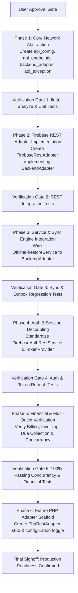

# Safe API Standardization & Refactoring Plan
**Project**: Shree Balaji Enterprises Billing ERP (`NubiBillingSoftware`)  
**Mode**: `AUDIT_FIRST_THEN_SAFE_REFACTOR` (Awaiting User Approval Prior to Execution)  
**Execution Timestamp**: October 23, 2026  
**Auditor**: Antigravity Senior Mobile Architect & API Migration Specialist  
**Status**: PROPOSED (Execution Pending Explicit User Approval)

---

## 1. Refactoring Policy & Principles

To guarantee zero business disruption, zero data corruption, and complete financial safety, all code modifications will strictly adhere to the following policies:
1. **Audit First**: Audit is complete. Production-code refactoring will **NOT** begin until the user explicitly reviews and approves this plan.
2. **Zero Breaking UI Changes**: Public repository contracts will remain identical so that UI widgets, ViewModels, and `AppController` require zero alterations.
3. **Preserve Local SQLite Schema**: Local SQLite table structures, indexes, outbox queues, and schema versioning (`LocalDatabase.schemaVersion = 15`) will not be modified.
4. **Preserve Strict Financial Safety**: The online-only restriction for financial mutations (`SyncOutboxRepository.financialCollections`) will remain strictly enforced.
5. **Feature-by-Feature Incremental Rollout**: Refactoring will be delivered in small, testable phases, each protected by comprehensive verification gates.

---

## 2. Phased Refactoring Roadmap

---

## 3. Phase-by-Phase Implementation Details

### Phase 1: Core Network Abstraction Layer
- **Action**: Introduce standard, clean contracts without touching existing services.
- **Files to Create**:
  - `lib/core/config/api_config.dart`: Centralized backend configuration, URLs, and timeout settings.
  - `lib/core/network/api_endpoints.dart`: Static definitions of all backend endpoints and entity routes.
  - `lib/core/network/api_exception.dart`: Normalized application exception classes (`ApiException`, `ApiErrorCode`).
  - `lib/core/network/api_response.dart`: Standardized API response container with metadata.
  - `lib/core/network/auth_token_provider.dart`: Interface for injecting and refreshing authorization tokens.
  - `lib/core/network/backend_adapter.dart`: Backend-independent data adapter contract (CRUD, query, batch transactions).
- **Verification Gate**: `flutter analyze` passes with zero new warnings; contract unit tests pass.

### Phase 2: Firebase REST Adapter Implementation
- **Action**: Wrap the existing Google Cloud Firestore REST logic inside a clean `BackendAdapter` implementation.
- **Files to Create / Modify**:
  - Create `lib/data/remote/firebase_rest_adapter.dart`: Implements `BackendAdapter`. Encapsulates `FirestoreValueCodec`, structured queries, and `:commit` batches.
  - Modify `lib/data/services/firestore_rest_service.dart`: Delegate underlying network requests through the centralized `ApiClient` and `ApiEndpoints`.
- **Verification Gate**: `flutter test test/firestore_sync_rest_test.dart` passes.

### Phase 3: Data Service & Sync Engine Integration
- **Action**: Refactor `OfflineFirestoreService` and `SyncEngine` to communicate with `BackendAdapter` rather than directly depending on Firestore-specific REST classes.
- **Files to Modify**:
  - `lib/data/services/offline_firestore_service.dart`: Change internal `remote` dependency from `FirestoreRestService` to `BackendAdapter`.
  - `lib/data/sync/sync_engine.dart`: Communicate via `BackendAdapter`.
- **Verification Gate**: `flutter test test/offline_sync_test.dart` passes.

### Phase 4: Auth & Session Management Decoupling
- **Action**: Centralize auth endpoints and decouple token management.
- **Files to Modify**:
  - `lib/data/services/firebase_auth_rest_service.dart`: Update to reference `ApiConfig.authBaseUrl` and `ApiEndpoints`.
  - `lib/data/repositories/auth_repository.dart`: Implement `AuthTokenProvider` interface.
- **Verification Gate**: `flutter test test/offline_auth_test.dart` passes.

### Phase 5: Financial Operations & Repository Verification
- **Action**: Ensure all 26 repositories operate cleanly through the abstracted data layer without breaking changes.
- **Repositories to Verify**:
  - `BillingRepository`, `CustomerRepository`, `PurchaseRepository`, `ProductRepository`, `InventoryRepository`, `StaffSalaryRepository`, `ReportsRepository`.
- **Verification Gate**:
  - `flutter test test/online_only_financial_transactions_test.dart` (All 20 scenarios pass).
  - `flutter test test/financial_e2e_security_concurrency_test.dart` (All 16 scenarios pass).

### Phase 6: Future PHP Adapter Scaffold
- **Action**: Create the placeholder adapter for future PHP/PostgreSQL deployment.
- **Files to Create**:
  - `lib/data/remote/php_rest_adapter.dart`: Implements `BackendAdapter` using standard REST JSON payloads, preparing the client for immediate drop-in replacement when the PHP backend is deployed.
- **Verification Gate**: Full integration suite passes with `activeBackend == BackendType.firebaseRest`.

---

## 4. Comprehensive Impacted Files Matrix

| File Path | Nature of Change | Risk Level | Mitigation Strategy |
| :--- | :---: | :---: | :--- |
| `lib/core/config/api_config.dart` | **New File** | None | Pure configuration; zero runtime dependencies |
| `lib/core/network/api_endpoints.dart` | **New File** | None | Static string definitions |
| `lib/core/network/api_exception.dart` | **New File** | None | Standalone exception classes |
| `lib/core/network/api_response.dart` | **New File** | None | Standalone response container |
| `lib/core/network/auth_token_provider.dart` | **New File** | None | Abstract interface |
| `lib/core/network/backend_adapter.dart` | **New File** | None | Abstract interface |
| `lib/data/remote/firebase_rest_adapter.dart` | **New File** | Low | Implements interface; wraps tested code |
| `lib/data/remote/php_rest_adapter.dart` | **New File** | None | Scaffold stub; not active in production |
| `lib/core/network/api_client.dart` | Modify | Low | Centralize headers & timeouts; retain existing methods |
| `lib/data/services/firebase_auth_rest_service.dart` | Modify | Low | Point to `ApiConfig.authBaseUrl` and `ApiEndpoints` |
| `lib/data/services/offline_firestore_service.dart` | Modify | Medium | Keep SQLite logic untouched; accept `BackendAdapter` |
| `lib/data/sync/sync_engine.dart` | Modify | Medium | Keep sync outbox untouched; call `BackendAdapter` |
| `lib/main.dart` | Modify | Low | Wire dependencies in composition root |
| **All UI Presentation Files** (`lib/presentation/`) | **UNTOUCHED** | **ZERO** | Completely insulated behind repositories |
| **SQLite Schema & Tables** (`lib/data/local/`) | **UNTOUCHED** | **ZERO** | Zero database migrations or schema modifications |

---

## 5. Explicit Approval Gate

In accordance with strict project instructions:
> **"Audit first; do not immediately rewrite the project. Wait for explicit approval before refactoring."**

Refactoring will commence only upon receiving explicit user confirmation to proceed with the phases outlined above.
